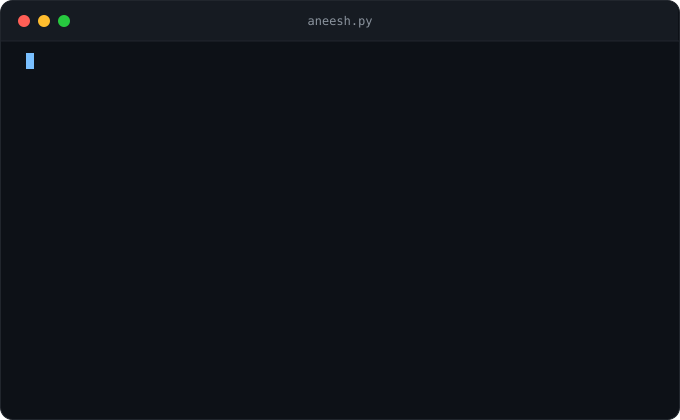
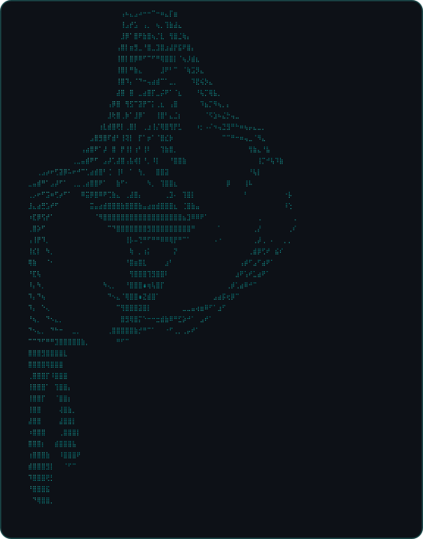

### 

<h1 align="center">Hi 👋, I'm Aneesh</h1>
<h3 align="center">A passionate developer, tech enthusiast, and open-source contributor from India.</h3>

  
  

---

### 🚀 About Me & Miku

  
  

- 🌱 I’m currently exploring full-stack web development, backend architectures, and AI tools.
- 🔭 Working on building cool open-source projects and interactive apps.
- 💬 Ask me about coding, web technologies, or anything tech-related!

---

### 💻 Languages & Tech Stack

  
  
  
  
  
  
  

---

### 📊 GitHub Stats & Streaks

  
  

---

### 🐍 Contribution Snake Animation

<picture>
  <source media="(prefers-color-scheme: dark)" srcset="https://raw.githubusercontent.com/aneesh505/aneesh505/output/github-snake-dark.svg" />
  <source media="(prefers-color-scheme: light)" srcset="https://raw.githubusercontent.com/aneesh505/aneesh505/output/github-snake.svg" />
  
</picture>

---

### 🌐 Connect with Me

  
  
  

